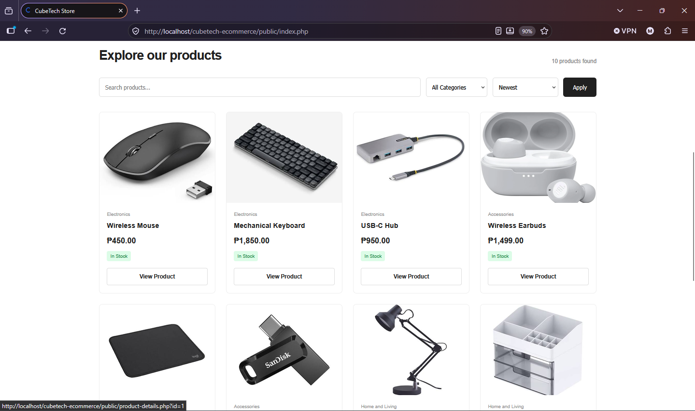

# CubeTech E-Commerce System

A responsive PHP and MySQL e-commerce website developed for the CubeTech Innovations Web Development Internship Assessment.

The system provides two connected interfaces: a customer-facing storefront for browsing products and placing orders, and an admin dashboard for managing products, categories, customers, and orders.

## 1. Project Overview

The CubeTech E-Commerce System demonstrates a complete shopping workflow, from product browsing and checkout to order processing and inventory management.

The application uses PHP for server-side processing and MySQL for persistent data storage. Both the customer storefront and admin dashboard work with the same database.

## 2. Technologies Used

- **Backend:** PHP
- **Database:** MySQL
- **Frontend:** HTML, CSS, JavaScript
- **Database Connectivity:** PHP Data Objects (PDO)
- **Development Environment:** XAMPP
- **Version Control:** Git and GitHub

## 3. Main Features

### Customer Website

- Responsive homepage and product catalog
- Product search, category filtering, and price sorting
- Product details and related products
- Product stock availability display
- Shopping cart with quantity updates and item removal
- Persistent cart contents
- Customer registration, login, and account management
- Checkout with customer and delivery information
- Payment method selection:
  - Cash on Delivery
  - E-Wallet
  - Bank Transfer
- Order confirmation with order information
- Customer order history and order details

### Admin Dashboard

- Admin login and logout
- Dashboard statistics and sales overview
- Product management (add, view, edit, and delete)
- Category management
- Customer records
- Order management and order details
- Order status updates
- Inventory and stock monitoring
- Automatic stock deduction after successful orders
- Stock restoration when eligible orders are cancelled
- Excel export for product, inventory, and sales records

### Order and Inventory Processing

- Server-side validation during checkout
- Stock availability verification
- Automatic order total calculation
- Order item records preserve product names and prices at the time of purchase
- Inventory updates after successful order placement
- Stock restoration for eligible cancellations
- Completed-order sales calculations

## 4. Installation and Setup

### Requirements

- Windows, macOS, or Linux
- XAMPP or another PHP/MySQL development environment
- PHP with PDO MySQL enabled
- MySQL or MariaDB
- Web browser

### Step 1: Clone the Repository

Open a terminal and run:

```bash
git clone https://github.com/YOUR_USERNAME/CubeTech-E-Commerce.git
```

Move the project into your XAMPP `htdocs` directory.

### Step 2: Start XAMPP

Start the following services:

- Apache
- MySQL

### Step 3: Create the Database

1. Open phpMyAdmin at `http://localhost/phpmyadmin/`.
2. Create a database named `cubetech_ecommerce`.
3. Select the newly created database.
4. Import the SQL files from the project's `database` folder.

Import the files in the appropriate order:

1. `schema.sql`
2. `seed.sql`
3. `customer_accounts.sql`

The SQL files provide the database structure and sample records. If the account-related tables are already included in the main schema, avoid importing duplicate table definitions.

### Step 4: Configure the Database Connection

Open:

```text
app/config/database.php
```

Update the database connection settings according to your local MySQL configuration.

Example:

```php
$host = '127.0.0.1';
$dbname = 'cubetech_ecommerce';
$username = 'root';
$password = '';
```

For a different database setup, replace the username and password with your local credentials.

Do not publish real database credentials or production secrets in a public repository.

### Step 5: Run the Application

Open the customer website:

```text
http://localhost/cubetech-ecommerce/public/
```

Open the admin dashboard login:

```text
http://localhost/cubetech-ecommerce/public/admin/login.php
```

## 5. Demo Admin Credentials

Use the demo administrator account configured in the sample database.

| Field    | Value         |
| -------- | ------------- |
| Username | `admin`       |
| Password | `Admin@12345` |

These credentials are for local assessment demonstration only. Change them before using the application in any shared or production environment.

## 6. Application Routes

| Page                  | Route                          |
| --------------------- | ------------------------------ |
| Homepage              | `/public/`                     |
| Product Details       | `/public/product-details.php`  |
| Shopping Cart         | `/public/cart.php`             |
| Checkout              | `/public/checkout.php`         |
| Customer Login        | `/public/login.php`            |
| Customer Registration | `/public/register.php`         |
| Customer Account      | `/public/account.php`          |
| Customer Orders       | `/public/orders.php`           |
| Admin Login           | `/public/admin/login.php`      |
| Admin Dashboard       | `/public/admin/index.php`      |
| Admin Products        | `/public/admin/products.php`   |
| Admin Categories      | `/public/admin/categories.php` |
| Admin Customers       | `/public/admin/customers.php`  |
| Admin Orders          | `/public/admin/orders.php`     |

## 7. Database and System Flow

The application uses a shared MySQL database for customer and administrator operations.

### Main Data Entities

- **Customers / Customer Accounts:** Stores customer account information and customer details.
- **Categories:** Stores product categories.
- **Products:** Stores product information, prices, stock quantities, and active/inactive status.
- **Orders:** Stores customer order information, payment method, order status, and totals.
- **Order Items:** Stores the products, quantities, and purchase-time prices associated with each order.

### Order Processing Flow

1. Customers browse products and add items to their cart.
2. Customers proceed to checkout and submit their order details.
3. The server validates the submitted information and checks product prices and stock availability.
4. The system saves the order and its corresponding order items.
5. Product inventory is updated after a successful order.
6. The customer receives an order confirmation.
7. The administrator views and manages the order through the dashboard.
8. Changes to order status are reflected in the stored order records.

## 8. Order Status Workflow

The order workflow follows these statuses:

```text
Pending → Confirmed → Preparing → Shipped → Completed
```

Eligible orders can be cancelled while they are Pending or Confirmed. When an eligible order is cancelled, the system restores the corresponding inventory.

Completed and Cancelled orders are treated as final statuses.

## 9. Storage Approach and Limitations

This project uses a backend/database storage approach with PHP and MySQL.

Unlike a browser-only LocalStorage implementation, the application stores its product, category, customer, and order records in a shared database.

The application uses server-side processing for important operations, including checkout validation, price calculations, and inventory updates.

### Limitations

- The payment methods are selections only. No actual payment processing or payment gateway is integrated.
- Shipping integrations and automatic delivery tracking are not included.
- The application is intended for local assessment demonstration and requires additional deployment and security configuration before production use.
- The database connection must be configured for the environment where the application runs.

## 10. Testing and Verification

The application should be evaluated using the assessment's acceptance checks.

| No. | Acceptance Check                                                                                                          | Result |
| --- | ------------------------------------------------------------------------------------------------------------------------- | ------ |
| 01  | Product search, category filtering, and price sorting work together.                                                      | Pass   |
| 02  | Cart quantities, persistence, and total calculations work correctly.                                                      | Pass   |
| 03  | Empty checkout and invalid customer information are rejected.                                                             | Pass   |
| 04  | Inactive and out-of-stock products cannot be ordered. Checkout checks current prices and availability.                    | Pass   |
| 05  | Successful orders appear in the admin dashboard and update inventory correctly.                                           | Pass   |
| 06  | Admin product and category changes are reflected on the customer website. Referenced records are protected from deletion. | Pass   |
| 07  | Valid order status changes work and eligible cancellations restore stock only once.                                       | Pass   |
| 08  | Dashboard sales and customer summaries match the underlying order records.                                                | Pass   |
| 09  | Existing order item details remain unchanged after product edits.                                                         | Pass   |
| 10  | Customer and admin interfaces work on desktop and mobile screen sizes.                                                    | Pass   |

Record the actual Pass, Fail, or Not Tested result and a short explanation for each check before submission.

## 11. Screenshots and Demonstration

The assessment submission should include:


### Customer Homepage


- Mobile screenshots of the customer website.
- Screenshots of the admin dashboard and management pages.
- A completed acceptance test log.
- A 3–5 minute demonstration video showing a customer purchase and its management through the admin dashboard.

## 12. AI Assistance Disclosure

AI assistance was used during development for technical guidance, code explanation, debugging, documentation, and reviewing implementation approaches. I used CLAUDE and CHATGPT in developing this project.


## 13. Project Information

**Project:** CubeTech E-Commerce System
**Assessment:** Web Development Internship Assessment
**Company:** CubeTech Innovations
**Developer:** Victor Libutlibut

